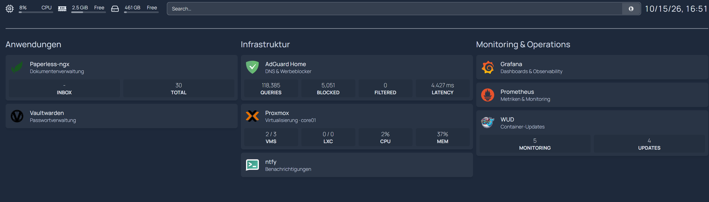
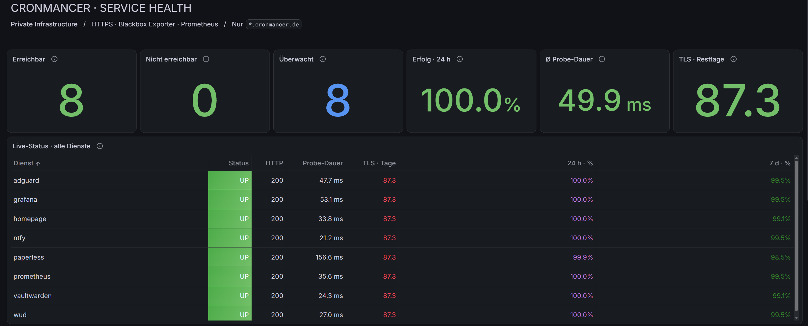
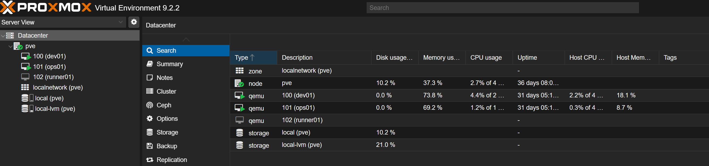
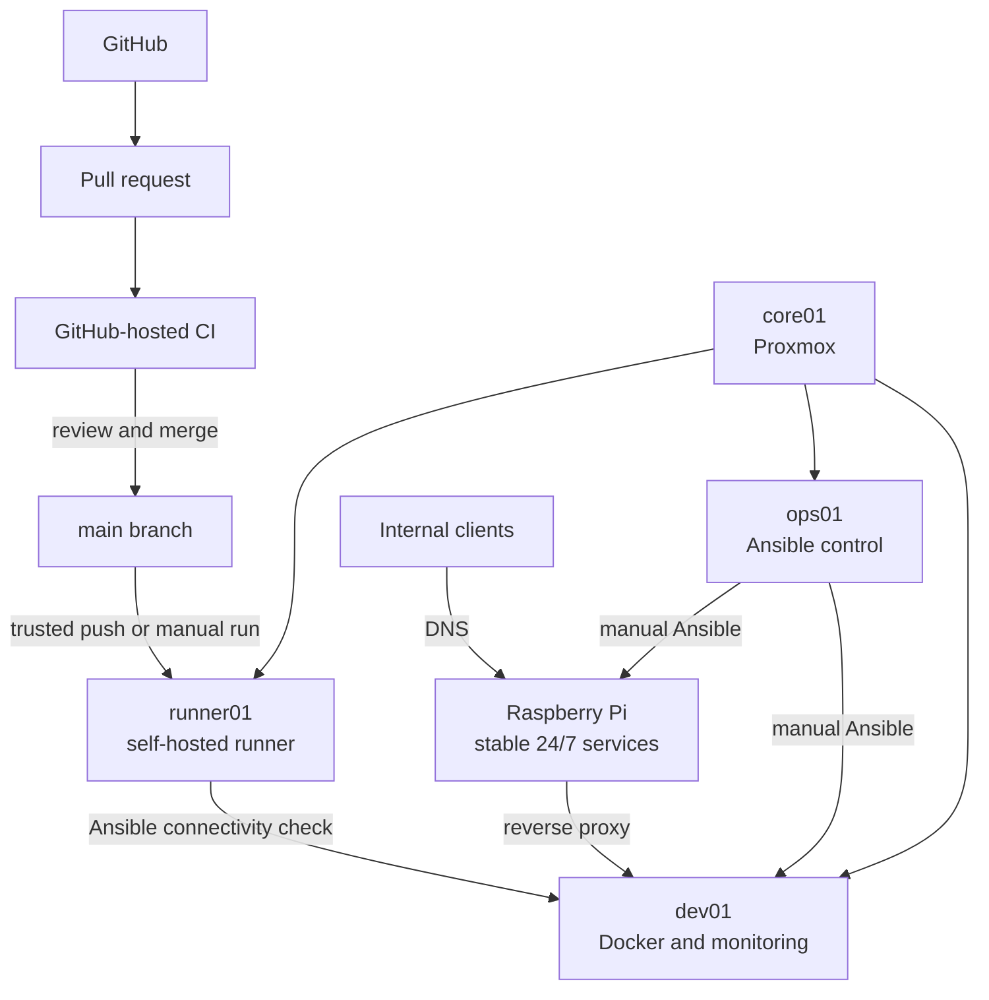
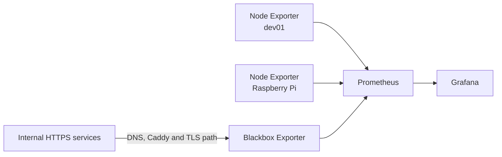

# Homelab Platform

A practical DevOps and platform engineering homelab built around Docker Compose, Ansible, GitHub Actions, Proxmox, Prometheus and Grafana.

The repository documents the move from individually managed services toward a small, reproducible platform: configuration is versioned, changes are reviewed, CI validates the repository, Ansible manages selected deployments, and monitoring and recovery are treated as part of normal operations.

> **Documented state: 15 October 2026.** Runtime claims in this README are dated snapshots based on verified checks and the supplied screenshots. The public repository contains reusable configuration and examples; inventories, credentials and persistent application data remain outside Git.

## What this project demonstrates

- service definitions with Docker Compose and persistent data kept outside Git,
- reusable Ansible roles for provisioning, firewall rules and service deployment,
- pull request based changes with YAML, Ansible and Compose validation,
- separation between public CI and the trusted self-hosted CD runner,
- internal DNS, reverse proxying and DNS-01 certificates without public inbound access,
- host metrics and HTTPS service checks with Prometheus, Blackbox Exporter and Grafana,
- encrypted backups with non-destructive restore tests,
- explicit distinction between implemented code, verified runtime state and planned work.

## Screenshots

### Service entry point



Homepage groups applications, infrastructure and operations tools. The widgets expose useful operating signals without replacing the monitoring stack. Captured on 15 October 2026.

### HTTPS service health



Grafana summarizes eight HTTPS probes through the real internal access path. The values are a point-in-time view rather than an availability guarantee. Captured on 15 October 2026.

### Virtualization



Proxmox hosts separate VMs for development, manual operations and the self-hosted GitHub Actions runner. Captured on 15 October 2026.

Additional Grafana views are available in the [screenshot gallery](docs/assets/screenshots/README.md).

## Architecture



| System | Responsibility |
|---|---|
| `core01` | Proxmox hypervisor; application workloads run in VMs |
| `dev01` | Docker target, WUD, Prometheus, Blackbox Exporter, Grafana and Node Exporter |
| `ops01` | Manual Ansible control node and infrastructure operations |
| `runner01` | Isolated self-hosted runner for trusted CD jobs |
| Raspberry Pi | AdGuard, Caddy, Homepage, Paperless-ngx, Vaultwarden, ntfy and Node Exporter |

The hypervisor stays focused on virtualization. Administrative work, repository-controlled automation and application workloads use separate systems. The Raspberry Pi keeps core internal services available independently of the development VMs.

See [Architecture](docs/architecture.md) for the detailed design and trust boundaries.

## Repository layout

```text
homelab-platform/
├── .github/workflows/          # CI and trusted CD connectivity
├── automation/ansible/
│   ├── inventory/              # public examples; real inventory is ignored
│   ├── playbooks/
│   └── roles/
├── docs/                       # architecture, firewall and screenshots
└── services/                   # reusable Compose and service configuration
```

Service definitions are independent from host placement. A typical deployed service uses:

```text
/srv/stacks/<service>     deployed configuration
/srv/appdata/<service>   persistent state
```

This keeps runtime data out of the repository and allows configuration to be replaced without overwriting application state.

## Automation and delivery

### Continuous integration

The CI workflow is designed to run on GitHub-hosted runners for pushes and pull requests targeting `main`. It performs:

- `yamllint` checks for Ansible and service YAML,
- Ansible playbook syntax checks using the example inventory,
- `docker compose config --quiet` for every service definition.

The latest queried CI runs from 14 October 2026 ended with GitHub's `startup_failure` before a job was created. The workflow definition is present, but this README therefore does not claim a currently green CI run.

### Continuous delivery

The CD workflow is deliberately narrower than a full deployment pipeline. On pushes to `main` or manual execution it selects the isolated `runner01`, installs the declared Ansible collections, loads a runner-local inventory and runs:

```text
ansible all -m ping
```

The GitHub-to-runner-to-target connection was previously verified. The current workflow does not invoke a deployment playbook, so automated service deployment through GitHub Actions is not claimed.

Manual Ansible deployment from `ops01` is a separate path. It is used for controlled infrastructure changes and verification before broader automation is introduced.

## Services and configuration management

The repository currently contains definitions for:

- ACME certificate management,
- AdGuard Home and Caddy,
- Homepage, Paperless-ngx, Vaultwarden and ntfy,
- WUD,
- Node Exporter, Prometheus, Blackbox Exporter and Grafana.

Ansible roles cover base configuration, Docker, UFW, Caddy, ACME and the development monitoring services. Environment-specific values are supplied through ignored inventories and variable files; `.example` files document the expected structure.

## Observability



The documented monitoring state includes host metrics for `dev01` and the Raspberry Pi and eight HTTPS probes for AdGuard, Grafana, Homepage, ntfy, Paperless, Prometheus, Vaultwarden and WUD.

The Service Health dashboard exposes current reachability, HTTP status, probe duration, observed 24-hour and 7-day success ratios, status history and certificate lifetime. Historical ratios reflect available probe samples; they are not an SLA.

Prometheus configuration is validated with `promtool` before replacement. The invalid-configuration path was tested successfully. Execution of the reload handler after a real valid change remains a separate verification item.

## Internal HTTPS and ACME

Internal services use the `cronmancer.de` domain while remaining reachable only through the private network or VPN. Certificates are issued through DNS-01, so certificate issuance does not require public inbound ports.

The repository contains:

- a restricted `acme.sh` Compose service,
- an Ansible role for certificate paths, renewal tooling and systemd units,
- a Caddy role that renders and validates configuration before deployment,
- read-only certificate mounts into Caddy,
- local secret files with ownership and permission checks.

Wildcard certificate issuance, installation and a manual Caddy reload were verified in the documented state. The systemd timer is versioned, but unattended renewal still requires an end-to-end runtime verification before it is presented as proven.

## Backup and recovery

Important Paperless and Vaultwarden data is backed up with encrypted Restic repositories on network storage. The documented process includes retention and non-destructive restore smoke tests into temporary directories.

A successful backup job alone is not treated as proof of recoverability. Restore coverage for additional data and VM-level recovery remains planned work.

## Security boundaries

- Pull request code runs on GitHub-hosted runners, not inside the homelab.
- The self-hosted runner is used only for trusted `main` and manual CD events.
- Real inventories, `.env` files, SSH keys, API tokens and private keys stay outside Git.
- Public files use examples or variables for environment-specific values.
- Application state is stored outside the repository.
- Production changes are verified through service status, logs, health checks or functional tests.

The repository intentionally shows the public service domain and system roles. It does not publish credentials, private keys or internal IP addresses.

## Verified status

| Area | Evidence-backed status |
|---|---|
| Proxmox and VM separation | Visible in the supplied Proxmox snapshot from 15 October 2026 |
| Docker and reusable Ansible roles | Present in the repository; selected roles used in the documented environment |
| CI validation definition | Implemented; latest queried runs ended in `startup_failure` before job creation |
| Self-hosted CD path | Connectivity previously verified; workflow remains ping-only |
| Monitoring | Eight HTTPS services shown reachable in the 15 October 2026 Grafana snapshot |
| Grafana Service Health | Dashboard committed and operational snapshot supplied |
| Publicly trusted internal HTTPS | Wildcard issuance and manual installation/reload verified |
| Automatic certificate renewal | Automation versioned; unattended end-to-end renewal still to verify |
| Restic restore tests | Paperless and Vaultwarden smoke restores documented as successful |
| Grafana alert delivery to ntfy | Planned |
| Kubernetes / k3s | Not started |

## Documentation

- [Architecture and trust boundaries](docs/architecture.md)
- [Firewall model](docs/firewall.md)
- [Ansible automation](automation/ansible/README.md)
- [Screenshot gallery and publication notes](docs/assets/screenshots/README.md)

The private operational knowledge base contains concrete host state and change history. Public documentation is derived from it only after values and claims have been checked for publication.

## Next steps

1. Resolve the GitHub Actions `startup_failure` and restore a verifiable CI result.
2. Verify unattended ACME renewal, Caddy reload and failure notification end to end.
3. Configure Grafana alert delivery through ntfy and test failure plus recovery.
4. Confirm reproducible provisioning of the committed Grafana dashboard.
5. Extend CD from connectivity testing to one controlled deployment with post-deployment verification.

Additional platforms such as k3s and Terraform will be introduced only when they support a concrete operating or learning objective.