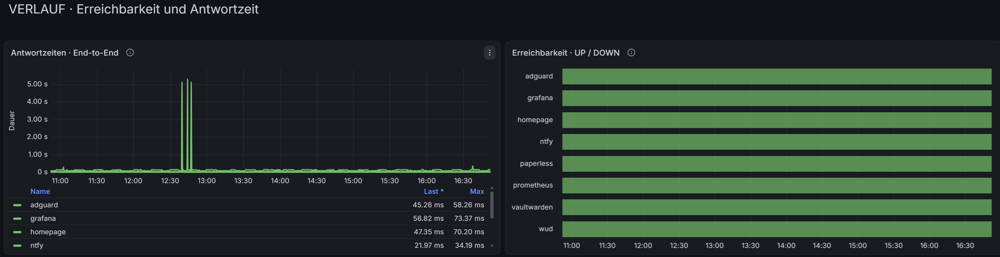
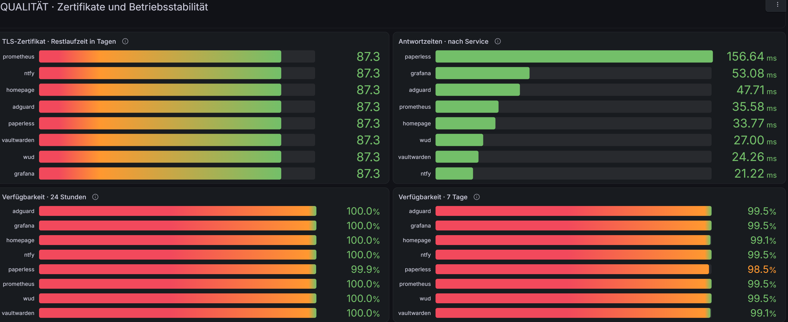

# Screenshot gallery

These screenshots show the real homelab state captured on 15 October 2026. They are operational snapshots, not evidence of continuous availability.

## Homepage

Homepage groups applications, infrastructure and operations tools. The visible widgets provide selected live values from Paperless, AdGuard, Proxmox and WUD.

## Grafana Service Health

The overview shows eight reachable HTTPS services, current response times, HTTP status and observed 24-hour and 7-day success ratios.

The timeline shows end-to-end probe duration and UP/DOWN history through internal DNS, Caddy and TLS.

The quality view compares TLS certificate lifetime, current response times and observed availability windows.

## Proxmox

The Proxmox overview shows the separation between `dev01`, `ops01` and `runner01`. Resource values and uptime reflect the capture time.

## Publication rules

Only screenshots from the real environment are stored here. Before committing a new image, inspect the complete capture for:

- passwords, access tokens and private keys,
- internal IP addresses and private URLs,
- account names and browser profile details,
- personal documents or notification content,
- terminal history and unrelated browser tabs.

Captions must include the real capture date. Screenshots must not be presented as proof of continuous availability or as a replacement for configuration and runtime verification.